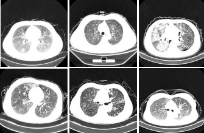
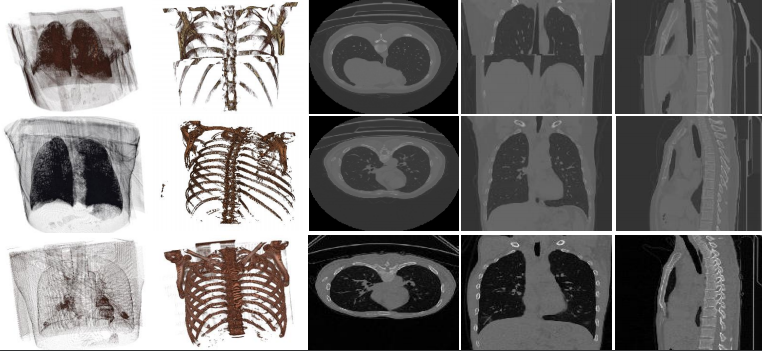
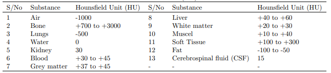
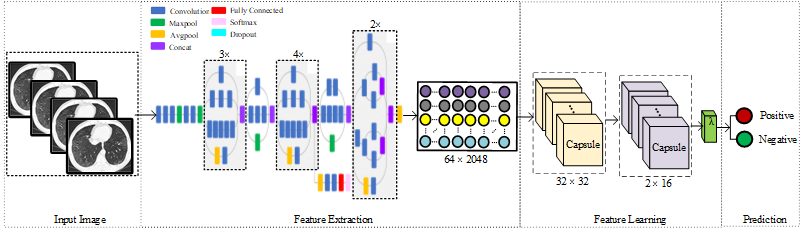
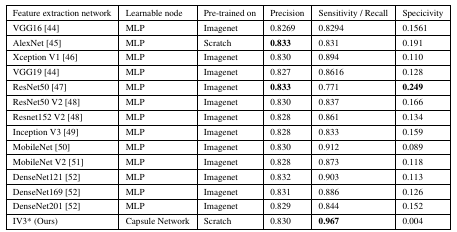

# CC-19: A Comprehensive COVID-19 CT Scan Dataset for Deep Learning Applications

[](https://github.com/abdkhanstd/COVID-19)
[](https://doi.org/10.1109/JSEN.2021.3076767)
[](LICENSE)
[](https://tensorflow.org/)

## Abstract

The CC-19 dataset represents a meticulously curated collection of computed tomography (CT) scan slices specifically compiled for advancing artificial intelligence applications in clinical medicine, particularly focusing on COVID-19 detection and analysis. This comprehensive dataset addresses the critical need for high-quality medical imaging data in the development of robust diagnostic systems during pandemic scenarios.

Our dataset encompasses **34,006 CT scan slices** derived from **89 subjects**, comprising **68 confirmed COVID-19 positive cases** and **21 negative cases**. The collection methodology prioritized clinical relevance and diagnostic utility, ensuring that each CT scan maintains the essential radiological characteristics necessary for accurate machine learning model development. The dataset's compilation involved extensive preprocessing and quality assurance protocols to eliminate inconsistencies while preserving the crucial diagnostic information embedded within the Hounsfield Unit (HU) measurements.

## Dataset Characteristics

### Clinical Composition

The CC-19 dataset demonstrates careful stratification across patient demographics and clinical presentations. The cohort includes diverse anatomical variations reflecting real-world clinical scenarios, with **28,395 CT slices** belonging to confirmed positive COVID-19 patients. This distribution provides sufficient representation for both binary classification tasks and more nuanced diagnostic applications requiring detailed pathological understanding.

Patient selection criteria emphasized diagnostic clarity and scan quality, with systematic exclusion of ambiguous cases that could introduce training bias. The varying slice counts across patients—ranging from standard thoracic protocols to extended coverage—reflect authentic clinical imaging protocols while accounting for individual anatomical differences and scanning procedures.

### Technical Specifications

Each CT scan maintains native resolution and bit depth, preserving the full dynamic range of HU values essential for quantitative analysis. The cylindrical scanning bounds inherent to CT acquisition naturally eliminate extraneous peripheral information, providing pre-aligned regions of interest without requiring extensive spatial preprocessing. This characteristic significantly streamlines the data preparation pipeline while maintaining clinical authenticity.

## Visual Dataset Overview

### 2D Slice Representation

*Representative 2D CT slices demonstrating the morphological diversity within the CC-19 dataset, showcasing various pathological presentations and anatomical orientations*

### Volumetric 3D Visualization

*Comprehensive 3D volumetric representations illustrating multi-planar reconstructions (XY, XZ, YZ) alongside extracted bone structures using differential HU thresholding. Each row represents distinct patient cases with varying Hounsfield Unit characteristics*

## Preprocessing Methodology

### Hounsfield Unit Analysis

*Standardized Hounsfield Unit values for different anatomical structures and pathological conditions, providing quantitative reference ranges for automated tissue segmentation and feature extraction*

The preprocessing pipeline implemented rigorous quality control measures to ensure dataset consistency while preserving diagnostic integrity. Raw DICOM files underwent systematic evaluation for acquisition parameters, image quality metrics, and anatomical coverage. Cases exhibiting significant motion artifacts, incomplete coverage, or technical acquisition issues were systematically excluded to maintain dataset reliability.

Data standardization procedures included intensity normalization within physiologically relevant HU ranges, spatial resampling for consistent voxel dimensions, and systematic verification of patient metadata accuracy. These preprocessing steps ensure compatibility across different CT scanner manufacturers and acquisition protocols while maintaining the essential radiological characteristics required for effective machine learning applications.

## Proposed Deep Learning Architecture

### Modified Inception-Capsule Hybrid Network

*Architectural diagram of the proposed IV3*-Capsule hybrid network, illustrating the feature extraction pipeline utilizing modified Inception V3 components followed by dual-layer capsule network integration for enhanced spatial relationship modeling*

Our proposed methodology introduces a sophisticated hybrid architecture combining the representational power of convolutional neural networks with the spatial relationship modeling capabilities of capsule networks. The modified Inception V3 (IV3*) serves as the primary feature extraction backbone, incorporating architectural refinements specifically optimized for medical imaging applications.

The capsule network components provide enhanced capability for modeling spatial hierarchies and part-whole relationships crucial for accurate pathological assessment. This architectural combination demonstrates particular effectiveness in capturing the subtle morphological changes associated with COVID-19 pneumonia while maintaining computational efficiency suitable for clinical deployment scenarios.

## Experimental Validation

### Comparative Performance Analysis

*Comprehensive performance evaluation across established deep learning architectures, demonstrating sensitivity and specificity metrics. Bold values indicate optimal performance characteristics for each evaluation criterion*

Extensive experimental validation demonstrates the dataset's effectiveness for training robust COVID-19 detection systems. The capsule network architecture achieved superior sensitivity metrics, indicating excellent capability for identifying positive COVID-19 cases. Conversely, ResNet architectures demonstrated optimal specificity characteristics, suggesting complementary strengths across different network topologies.

These performance variations highlight the importance of architectural selection based on specific clinical requirements, with sensitivity prioritization for screening applications and specificity optimization for confirmatory diagnostic scenarios.

## Data Access and Distribution

### Primary Dataset Downloads

**Complete Dataset Archive** (16GB uncompressed, ~10GB compressed):
- [Primary Dataset](https://stduestceducn-my.sharepoint.com/:u:/g/personal/201714060114_std_uestc_edu_cn/EUucCIoQrEtPurKzMAOmJAEBS8fWlkyjukDJ5pHnvaQgeg?e=PirfhE)

**Format-Specific Downloads**:
- [DICOM Files](https://stduestceducn-my.sharepoint.com/:u:/g/personal/201714060114_std_uestc_edu_cn/EYxoLA3i8otNjb7YMrczZVABiMgC2auUqfoS-WRBa3f7VQ?e=nVnCBw) - Native medical imaging format with complete metadata
- [3D Slice Collections (JPEG)](https://stduestceducn-my.sharepoint.com/:u:/g/personal/201714060114_std_uestc_edu_cn/ETJI_4PBgVpPu7StGZ0wbwwBJMADKC0sqA01983MRP1XDw?e=449hGe) - Preprocessed slice exports
- [Supplementary Dataset](https://stduestceducn-my.sharepoint.com/:u:/g/personal/201714060114_std_uestc_edu_cn/EV2otzKXOglKlkCtyV_wlgQBwNCgMHlNe8yum1qfx_q71g?e=IwlFqb) - Additional validation samples

**Access Credentials**: Archive password is `thankyou`

### Future Dataset Expansion

We are currently negotiating access to significantly expanded patient cohorts, with anticipated inclusion of **30,000+ additional patient cases**. This substantial dataset augmentation will enable more comprehensive validation studies and support the development of increasingly robust diagnostic systems suitable for large-scale clinical deployment.

## Implementation Framework

### System Requirements

**Core Dependencies**:
```bash
tensorflow-gpu==1.14.0
keras==2.0.8
tqdm
pillow
numpy
```

### Dataset Organization

**Official Train/Test Splits**: Standardized partitioning protocols are provided to ensure reproducible experimental comparisons across research groups.

**Federated Learning Implementation**: Distributed training frameworks are included to support privacy-preserving collaborative model development across multiple institutions.

**3D Volume Processing**: Comprehensive utilities for volumetric data manipulation and multi-planar reconstruction generation.

## Research Applications

The CC-19 dataset enables diverse research applications spanning computer-aided diagnosis, federated learning implementations, and blockchain-secured medical data sharing protocols. The comprehensive annotation schema and rigorous quality control measures support both supervised learning approaches and more sophisticated semi-supervised methodologies requiring high-confidence ground truth labels.

Potential research directions include multi-modal fusion studies combining CT imaging with clinical laboratory data, longitudinal progression modeling for disease monitoring applications, and cross-institutional validation studies leveraging federated learning architectures to preserve patient privacy while enabling collaborative model development.

## Citation

When utilizing the CC-19 dataset, please reference our work using the following citation:

```bibtex
@article{kumar2021blockchain,
  title={Blockchain-federated-learning and deep learning models for covid-19 detection using ct imaging},
  author={Kumar, Rajesh and Khan, Abdullah Aman and Kumar, Jay and Golilarz, Noorbakhsh Amiri and Zhang, Simin and Ting, Yang and Zheng, Chengyu and Wang, Wenyong and others},
  journal={IEEE Sensors Journal},
  volume={21},
  number={14},
  pages={16301--16314},
  year={2021},
  publisher={IEEE},
  doi={10.1109/JSEN.2021.3076767}
}
```

**Alternative Citation Format**:
> R. Kumar et al., "Blockchain-Federated-Learning and Deep Learning Models for COVID-19 Detection Using CT Imaging," in IEEE Sensors Journal, vol. 21, no. 14, pp. 16301-16314, 15 July 2021, doi: 10.1109/JSEN.2021.3076767.

## Ethical Considerations

Dataset compilation adhered to stringent ethical guidelines and institutional review board protocols. All patient data underwent comprehensive anonymization procedures while preserving essential diagnostic information. The collection methodology prioritized patient privacy protection and compliance with international medical data sharing standards.

Researchers utilizing this dataset are expected to maintain equivalent ethical standards and ensure appropriate institutional oversight for medical imaging research applications.

## Contact and Support

For technical inquiries, dataset access issues, or research collaboration opportunities, please contact the corresponding authors through institutional channels or utilize the repository's issue tracking system for community-based support.
